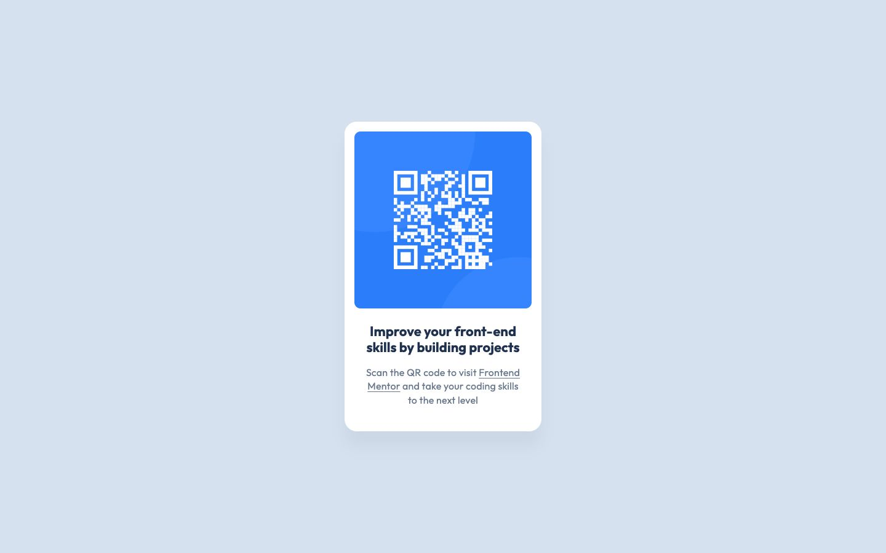

# Frontend Mentor - QR code component solution

This is a solution to the [QR code component challenge on Frontend Mentor](https://www.frontendmentor.io/challenges/qr-code-component-iux_sIO_H). The page shows a responsive card with a QR code and a text link that both open Frontend Mentor.

## Table of contents

- [Overview](#overview)
  - [The challenge](#the-challenge)
  - [Screenshot](#screenshot)
  - [Links](#links)
- [My process](#my-process)
  - [Built with](#built-with)
  - [What I learned](#what-i-learned)
  - [Continued development](#continued-development)
- [Run it locally](#run-it-locally)
- [Author](#author)

## Overview

### The challenge

Users should be able to:

- View the QR code card on mobile and desktop, following the supplied designs.
- Scan the QR code to visit Frontend Mentor.
- Open the same destination through the text link, including with a keyboard.

### Screenshot



### Links

- Solution URL: [QR code card solution on Frontend Mentor](https://www.frontendmentor.io/solutions/qr-code-card-with-nextjs-typescript-and-tailwind-sRz-8peZNN)
- Live Site URL: [QR Code Card](https://qr-code-card.royeradames.com)

## My process

### Built with

- Next.js 16.3.6 and React 19.2.8
- TypeScript 5.9.3
- Tailwind CSS 4.2.1 and custom CSS
- CSS Grid for centring the card
- Outfit through `next/font/google`
- Playwright for browser tests
- ESLint

### What I learned

I built the first PR from the free brief. In PR 2, I brought in the design's copy and exact colours. I learned to start from the decoded Figma design. The current card uses the 320 px card width, 288 px QR image and 22 px heading from the design. The supplied mobile and desktop images are in `reference/design/`.

I also added site identity in PR 2. I use the same "QR Code Card" name for `og:site_name` and WebSite JSON-LD. Next.js generates a 1200 x 630 Open Graph image at build time.

I learned to add the 320 to 1600 px regression suite on day one. The current Playwright suite checks widths in 10 px steps for horizontal overflow, card gutters and text below 16 px. It also checks the design frames, keyboard focus and rendering without JavaScript. I added a text link beside the QR code so visitors can open Frontend Mentor without a second device.

### Continued development

- I still need browser coverage beyond Chrome. The current Playwright configuration only runs Chrome; Firefox and WebKit are not covered.

## Run it locally

Use Node.js 24.

```bash
npm ci
npm run dev -- --port 3000
```

Open `http://localhost:3000`. To run the checks:

```bash
npm run lint && npm run typecheck && npm run build
npm test
```

Playwright uses an installed Chrome browser and starts the production server on `127.0.0.1:4681` by default. Build before running the tests. Set `PORT` to change the test server port.

I keep body text at 16 px instead of the design's 15 px to meet my 16 px text floor.

## Author

- Website - [Royer Adames](https://royeradames.com)
- Frontend Mentor - [@royeradames](https://www.frontendmentor.io/profile/royeradames)
